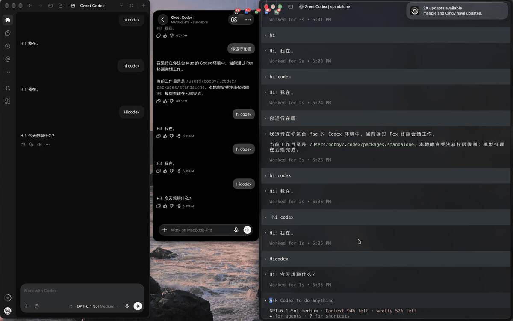

# ChatGPT Daemon Bridge

[简体中文](README.md) | [English](README.en.md)

Connect ChatGPT Desktop on macOS to an existing Codex Managed Daemon through a local bridge, sharing the same session service with CLI and iPhone clients connected to that daemon.

This is an experimental connection workaround, not an official OpenAI fix. **It currently does not preserve full `codex_app` desktop control tool functionality.**

## Demo

An example of the same conversation updating across Desktop, iPhone, and CLI. The animation below provides an inline preview (about 2.9 MB). Click it to view or download the compressed MP4 with audio (about 29 seconds, 1.2 MB).

<a href="assets/demo.mp4?raw=true"></a>

[Watch / download the video](assets/demo.mp4?raw=true)

## Background

Some Desktop versions only honor `CODEX_APP_SERVER_USE_LOCAL_DAEMON=1` when `configOverrides` is empty. However, Desktop automatically adds a `codex_app` plugin override, causing it to start a separate stdio App Server. When two servers try to resume the same session, they may report `already has an active writer`.

- [openai/codex#41014: Automatic overrides block daemon attachment](https://github.com/openai/codex/issues/41014)
- [openai/codex#40134: Support connecting Desktop to an externally managed App Server](https://github.com/openai/codex/issues/40134)

This project does not modify that condition. Instead, it uses `CODEX_CLI_PATH` to replace the CLI entry point launched by Desktop, turning its known app-server startup command into a connection to the existing daemon:

```text
ChatGPT Desktop
    ↕ stdio JSON lines
codex-desktop → bridge.cjs
    ↕ WebSocket over Unix socket
Existing Codex Managed Daemon
    ↕
CLI / iPhone
```

## Usage

Requirements:

- macOS, with ChatGPT installed at `/Applications/ChatGPT.app`.
- An installed and running Codex Managed Daemon.
- The managed CLI at `$CODEX_HOME/packages/standalone/current/bin/codex`; `CODEX_HOME` defaults to `~/.codex`.
- Node.js 20 or later and npm to install dependencies and run tests. The bridge prefers ChatGPT's bundled Node runtime, falling back to Node on PATH if unavailable.

From the cloned repository directory, run:

```sh
npm ci --ignore-scripts
npm test
codex app-server daemon version
```

To share the daemon across Desktop, CLI, and iPhone, start remote control first:

```sh
# Start the Managed Daemon with remote control enabled.
# Skip this if the daemon is already running with remote control enabled.
codex remote-control start
```

Once `codex app-server daemon version` reports `status: running`, **fully quit ChatGPT**, then run:

```sh
./launch-chatgpt.command
```

For local Desktop and CLI sharing only, you can start the daemon with `codex app-server daemon start` without enabling remote control. The CLI should also connect to the same daemon; avoid using `--no-daemon` to start a separate server.

You can also double-click `launch-chatgpt.command` in Finder. If ChatGPT is already running, `open` will not replace its existing launch environment.

The launcher sets `CODEX_CLI_PATH` only for this ChatGPT launch. It does not modify the global `config.toml`, launchctl environment, or application bundle. Keep the repository directory and `node_modules` in place.

## How it works

- `codex-desktop` only intercepts known Desktop app-server startup commands.
- Version queries, daemon management, and the `--print-startup-config` organization settings preflight are passed through to the real CLI.
- The two known startup overrides are not applied to the running daemon. Unknown startup overrides produce an error rather than silently discarding other configuration.
- `bridge.cjs` connects to `$CODEX_HOME/app-server-control/app-server-control.sock`, converts between JSON lines and WebSocket messages, and handles ping/pong.
- It does not start another App Server or open a TCP port. Exiting the bridge does not stop the daemon.

## Validation and limitations

Tested with ChatGPT `26.1029.61003` (build `24614`) and Managed Daemon `0.166.0`.

- `initialize`, `thread/list`, and the organization settings preflight succeeded.
- A real Desktop launch reported `initialized=true` and `connected`.
- The user confirmed in the UI that an existing session opened normally and its latest messages matched.
- The user-provided demo recording shows the same conversation and message updates across Desktop, iPhone, and CLI. It is not a long-term stability test.
- The `codex_app` desktop tools were not loaded through the startup arguments. Sharing the session service does not establish full desktop tool compatibility.
- The bridge does not apply additional feature flags to the existing daemon or transfer writer locks held by an older standalone server.
- The bridge does not reconnect on its own. Disconnection behavior depends on Desktop's connection lifecycle.
- Future changes to Desktop startup arguments, protocols, or paths may require updates to this project.

Tests use temporary Unix sockets. They do not connect to a real daemon or create real sessions.

## Restore default behavior

Fully quit ChatGPT, then launch the original ChatGPT.app or use its Dock icon. There is no need to sign out, stop the Managed Daemon, or delete any session locks.
